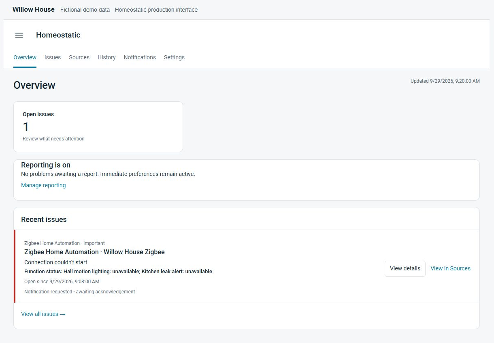
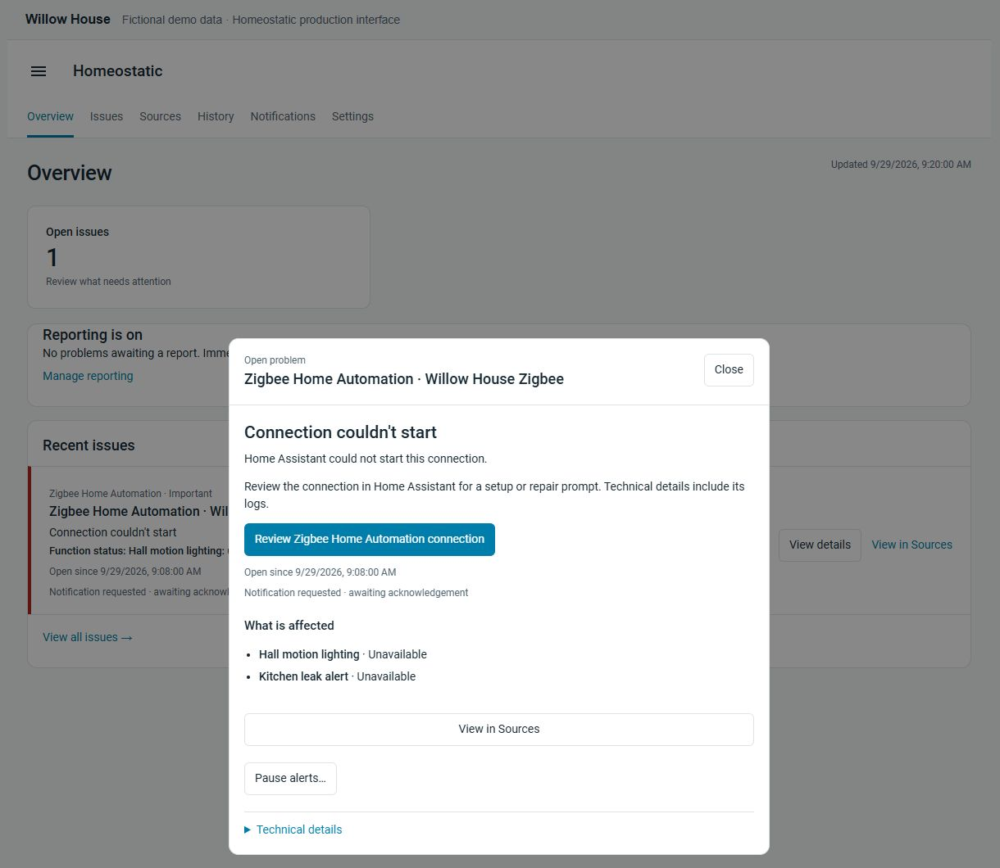
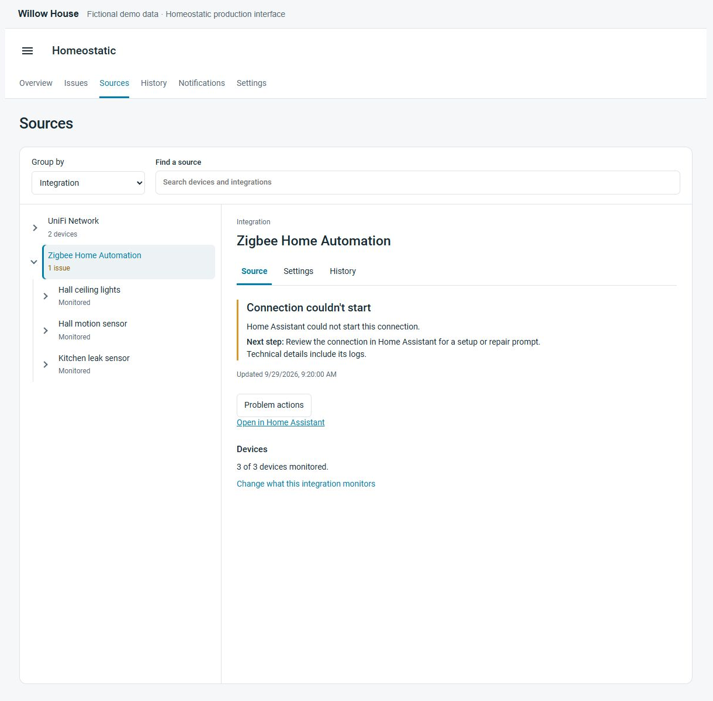
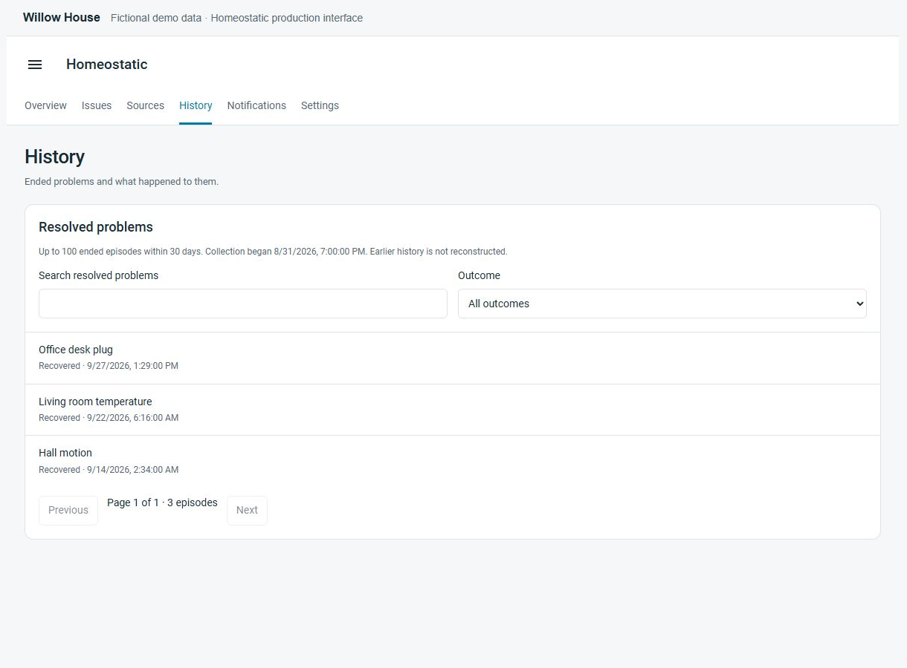

# Homeostatic

<p align="center"><picture><source media="(prefers-color-scheme: dark)" srcset="custom_components/homeostatic/brand/dark_icon.png"></picture></p>

Most Home Assistant failures are silent. An integration fails after an update, a switch drops off the network, a battery dies, an automation breaks when an entity is renamed. You find out when friends are over and "Alexa, turn on the back deck lights" does nothing.

Home Assistant knew. It marked the deck switch unavailable on Tuesday and didn't tell anyone.

Homeostatic makes Home Assistant easier to run. It tracks what's broken, failing or misbehaving and tells you on your terms: right away, in a morning or evening summary, or once a week. With the deck switch on the morning summary, you'd have known on Wednesday. When a whole integration goes down, you get one issue listing everything behind it, instead of forty alerts.

It covers:

- Integrations that won't start, keep retrying, or need you to sign in again
- Devices and entities that go unavailable
- Batteries running low
- UPS backup operation, low reserve, replacement warnings and faults from NUT or APC UPS Daemon
- Thermostat progress and temperature limits you configure
- Vacuums that report an error
- Repairs Home Assistant raises, like an automation calling an action that no longer exists
- Automations that name an entity that no longer exists
- Situations in the house you ask it to watch, like water on the basement floor or the garage left open after dark

[](https://hacs.xyz/docs/faq/custom_repositories/)
[](https://analytics.home-assistant.io/custom_integrations.json)
[](https://github.com/mjcumming/homeostatic/releases)
[](https://github.com/mjcumming/homeostatic/actions/workflows/ci.yml)
[](https://www.home-assistant.io/)
[](LICENSE)

<p align="center">
  
</p>

<p align="center"><small>The Overview page in a demo house, with one Zigbee problem open.</small></p>

> Using Homeostatic? Please [star the repo](https://github.com/mjcumming/homeostatic). It helps other Home Assistant users find it.

## What it watches

A new install watches integration, device and entity availability, Home Assistant's Repairs, and automations that name an entity that no longer exists. **Policies** shows these supplied policies alongside policies you add. Batteries and vacuums start off; temperature, thermostat and UPS checks need setup. Use **Sources** to inspect equipment and open the policies that watch it.

- A battery policy opens an issue at your chosen level, initially 20%, or when the device reports a low warning. It's tracked apart from whether the device is available.
- A vacuum issue opens when Home Assistant reports the vacuum's activity as error. Cleaning, docked, idle, paused, or returning ends it. Its notification message names the area Home Assistant assigned when there is one.
- A Repair's issue ends when Home Assistant stops reporting the Repair, or when you ignore it in Home Assistant.
- A broken automation is an automation that names an entity that no longer exists. The issue lists those entity ids and opens the automation in the editor. It ends when the entity exists again, the automation no longer names it, or the automation is removed.
- Alerts are ordinary Home Assistant automations made from a blueprint, so you get the full automation editor for the condition. If a sensor an alert needs goes offline, the alert shows *unknown*, so a dead leak sensor never reads as a dry floor.

## What you get when something goes wrong

An issue for each problem. It quotes what Home Assistant reported (setup failed, needs sign-in, retrying), lists the entities affected, suggests what to try, and lets you inspect recovery in its details. When an integration fails, the devices and entities you watch on it are listed on that one issue instead of each raising its own.

Each policy decides when and how to notify. Add an immediate notification, a scheduled summary, or both, and choose one or more delivery methods for each entry.

| Timing | What happens |
| --- | --- |
| Immediately | Sent when the problem begins, overnight included. Optionally repeat at your chosen interval until acknowledgment or recovery. |
| Scheduled summary | Open problems at a local time on the weekdays you choose, including problems already reported immediately or acknowledged. Cleared problems and empty summaries are omitted. |
| No notification entries | Dashboard only; monitoring continues. |

Create delivery methods inside a policy notification entry, or manage shared methods in **Notifications**, for phones, voice, email or SMS destinations configured in Home Assistant. Supplied policies have no notification entries, and the global notification switch starts off. After a Home Assistant restart, Homeostatic waits for your integrations to finish loading, then combines waiting notifications into summaries.

Controls for problems you already know about:

- *Acknowledge* tells everyone that someone has seen the issue. It stops the repeat reminders, and the issue stays open until the problem clears.
- *Pause alerts* silences one issue for up to a week.
- *Working on this equipment* is for planned work. It shows what will be affected, then holds off new issues for that equipment until the end time you set.

History of ended issues for 30 days, and a Home Assistant event for every change to an issue if you want to build your own automations on top.

## The panel

Homeostatic adds a sidebar panel for administrators:

| Page | What it's for |
| --- | --- |
| Overview | What's open and what's being watched |
| Issues | Problems needing review, with their details and controls |
| Sources | Inspect equipment and open the policies that watch it. |
| Policies | Edit, duplicate, disable or delete supplied and custom policies. Choose sources, detection settings and notifications. |
| Notifications | Reusable delivery methods with their own tests, and the global notification switch |
| Settings | Timing and problem grouping |
| History | Ended issues from the last 30 days |

If you use [TopoMation](https://github.com/mjcumming/topomation), Sources can also show your devices by its locations (property, buildings, floors, rooms) as well as by Home Assistant's floors and areas.

## How it works

Homeostatic builds a map of what depends on what: each device and entity you watch depends on its integration. When things fail, Homeostatic works out which failure explains the others and keeps one issue for that failure. The policy's notification entries decide when someone hears about it.

The reasoning comes from [Health Tree](https://github.com/mjcumming/health-tree), a separate Python library with no Home Assistant code in it. Homeostatic connects it to Home Assistant, keeps the history, draws the panel and sends the notifications.

## What it can't tell you

Homeostatic only knows what Home Assistant reports. If Home Assistant says a sensor is available, Homeostatic can't tell whether its reading is fresh, whether a detector has hung, or whether a command actually worked. Checks for those are on the [roadmap](docs/roadmap.md). The [user guide](docs/guide.md#what-an-availability-problem-means) explains what an availability warning does and doesn't mean.

It can't tell you Home Assistant itself has stopped, because it runs inside it. You need something outside Home Assistant for that.

The full list is in [Known limitations](docs/troubleshooting.md#known-limitations).

## Requirements

- Home Assistant 2026.9.3 or newer.
- Internet access the first time it loads, so Home Assistant can install the [health-tree](https://pypi.org/project/health-tree/) library from PyPI. After that, Homeostatic runs locally.
- An administrator account to set it up.

## Installation

### HACS (recommended)

1. In HACS, open the menu (⋮) and choose **Custom repositories**.
2. Add `https://github.com/mjcumming/homeostatic` with the type **Integration**.
3. Find **Homeostatic**, download version **1.7.1**, and restart Home Assistant.

[](https://my.home-assistant.io/redirect/hacs_repository/?owner=mjcumming&repository=homeostatic&category=integration)

### Manual

1. Download `homeostatic-1.7.1.zip` and its checksum from the [1.7.1 release](https://github.com/mjcumming/homeostatic/releases/tag/v1.7.1).
2. Copy its `custom_components/homeostatic` folder into your Home Assistant config folder, so you end up with `<config>/custom_components/homeostatic/manifest.json`. Replace any older copy completely.
3. Restart Home Assistant.

[Install and first run](docs/install.md) covers backups, checking the download and rolling back.

## Getting started

1. Go to **Settings → Devices & services → Add integration** and add **Homeostatic**.

   [](https://my.home-assistant.io/redirect/config_flow_start/?domain=homeostatic)

2. Open **Homeostatic** in the sidebar. Availability, Repairs and broken-automation monitoring are already on; notifications are off.
3. Open **Policies** and review what the supplied policies watch. Edit their sources and settings, or use **Add policy** to choose another monitoring type. Select **Save changes** to apply edits.
4. Enable battery or vacuum monitoring if wanted. Temperature, thermostat and UPS policies need sources and detection settings before use. Supplied and custom policies use the same editor.
5. Leave notifications off while you review the issues. When ready, add notification entries to the policies you want to hear from, choose or create their delivery methods within the policy, then enable the global notification switch in **Notifications** and save.

The [user guide](docs/guide.md) covers the rest: one integration's devices, policies, batteries, vacuums, notifications and the controls.

## Create your own alert

The condition lives in a Home Assistant automation, made from the Homeostatic alert blueprint. Homeostatic handles the issue, its history, the notifications and the Acknowledge button.

1. Import the [Homeostatic alert blueprint](https://github.com/mjcumming/homeostatic/blob/main/blueprints/automation/homeostatic/alert.yaml) under **Settings → Automations & scenes → Blueprints**. Or copy `alert.yaml` from the release zip into `blueprints/automation/homeostatic/` and reload automations.
2. Create an automation from the blueprint and fill it in:

   | Field | Example |
   | --- | --- |
   | Alert name | Basement water leak |
   | Notification message | Water detected near the basement water heater. |
   | Active when | Basement water sensor is Wet |
   | Required evidence | Basement water sensor |
   | Reporting preference | Immediate with acknowledgment |

   *Required evidence* is every entity the condition or the message depends on. If one of them goes unavailable, the alert shows unknown rather than clear.

3. Save it. While the condition holds there's one open issue, and it resolves when the condition clears. Turning the automation off doesn't count as the condition clearing.

Start a new alert on **Dashboard only** until you trust the condition. Both immediate choices send overnight.

The [alert guide](docs/automation-situations.md) covers writing the automation by hand, retiring an alert and converting alerts made the older way.

## Screenshots

From the same demo house as above.








## Dashboard cards

Any panel page can go on your own dashboards as a card. The card is for administrators, like the panel.

```yaml
type: custom:homeostatic-card
view: overview
```

| `view` | Shows |
| --- | --- |
| `overview` | Overview |
| `issues` | Issues |
| `sources` | Sources |
| `policies` | Policies |
| `notifications` | Notifications |
| `settings` | Settings |
| `history` | History |

There's also a ready-made Homeostatic dashboard. Pick it when you add a new dashboard in Home Assistant.

## Blueprints

| Blueprint | What it does |
| --- | --- |
| [Homeostatic alert](blueprints/automation/homeostatic/alert.yaml) | Makes an alert from Home Assistant conditions. Start here. |
| [Problem logbook](blueprints/automation/homeostatic/problem_logbook.yaml) | Writes issue changes to the logbook |
| [Report a situation](blueprints/automation/homeostatic/report_situation.yaml) | The older way to make an alert. It still works, but new alerts should use the alert blueprint. |
| [Diagnostic state](blueprints/template/homeostatic/diagnostic_state.yaml) | Turns a device's diagnostic entity, like a communication-error sensor, into a problem sensor Homeostatic can watch |

## Removing Homeostatic

1. Go to **Settings → Devices & services**, open Homeostatic and delete it. This also deletes its stored issues and history.
2. Remove it in HACS, or delete `<config>/custom_components/homeostatic`.
3. Restart Home Assistant.

Alerts you made from the blueprint are ordinary automations, so delete or disable those too. The [user guide](docs/guide.md#remove-homeostatic) lists everything else to tidy up.

## Documentation

| Guide | What's in it |
| --- | --- |
| [Install and first run](docs/install.md) | A guided first setup, from install to a test notification, plus upgrading and rolling back |
| [User guide](docs/guide.md) | Choosing what to watch, batteries, vacuums, notifications, the controls and removal |
| [Alerts from automations](docs/automation-situations.md) | Making alerts for conditions in the house |
| [How it works](docs/how-it-works.md) | How failures become issues and when they are reported |
| [Troubleshooting](docs/troubleshooting.md) | Common problems, and the full list of known limitations |
| [Reference](docs/reference.md) | Every option, timing, entity, action, card setting and blueprint |
| [Events](docs/events.md) | Building your own automations on Homeostatic's events |
| [Specification](docs/spec.md) | Exactly how it behaves, with every timing |
| [Decisions](docs/adr/README.md) | Why it works the way it does |
| [Roadmap](docs/roadmap.md) | What's next |
| [Changelog](CHANGELOG.md) | What changed |

Bug reports are welcome in [GitHub Issues](https://github.com/mjcumming/homeostatic/issues).

## Contributing

See [CONTRIBUTING.md](CONTRIBUTING.md) and the [development setup](docs/development.md). Behavior is written down in the [spec](docs/spec.md) before it changes, every change comes with a test scenario, and the tests run against an isolated Home Assistant, so nothing reaches a real phone.

```bash
uv sync --locked
uv run prek install
uv run python script/check.py --quick
```

## License

[MIT](LICENSE). To report a security problem, see [SECURITY.md](SECURITY.md).
