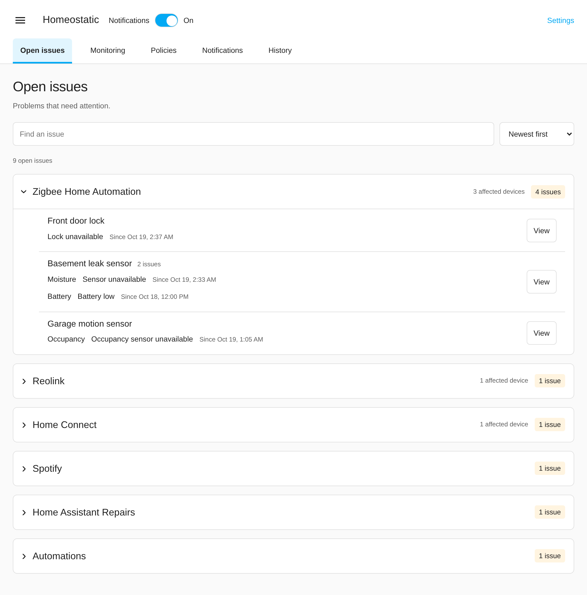

# Homeostatic

<picture><source media="(prefers-color-scheme: dark)" srcset="custom_components/homeostatic/brand/dark_icon.png"></picture>

Homeostatic tells you when something in your Home Assistant stops working. It watches your integrations, devices and Home Assistant Repairs from the moment you install it, and once you add your phone it tells you about problems on the schedule you choose. You set it up in its own sidebar panel; there are no automations or YAML to write.

## Why you'd want it

Home Assistant already knows when a lock drops off the network, an integration needs you to sign in again or a sensor's battery is nearly flat. It shows some of that under **Settings**, but it doesn't send it to anyone. Getting told has meant writing an automation for each thing you care about and updating those automations every time you add a device. Then one Zigbee coordinator crash sets off dozens of alerts.

Homeostatic does that work with policies. A policy says what to watch, what counts as a problem and how to tell you. It can select by kind of device, such as every lock or camera, or by area or label, so a lock you add next month is covered as soon as you add it. When Home Assistant reports a problem, Homeostatic opens an issue and notifies you; when the problem clears, it closes the issue and clears the phone notification. If an integration itself fails, you get one issue listing everything it took down instead of one per device, and problems that arrive together share one message.

## What you get

Out of the box:

- A lock, camera, alarm panel, or smoke, carbon monoxide, gas or leak detector that drops off Home Assistant reaches your phone in about a minute, day or night.
- Everything else arrives in one summary at 08:00: other unavailable entities, integrations that won't load or need you to sign in again, Home Assistant Repairs, entities an integration no longer provides, and automations that name entities that no longer exist. If nothing is open, no summary is sent.

From the same panel you can add policies for low batteries, vacuum errors, UPS power and battery, temperature limits for a freezer or a room, and thermostats that can't reach their target.

Notifications go wherever Home Assistant can send them: the Companion app on your phone, a speaker, email, SMS or another notify service. When one arrives, **Acknowledge** tells everyone you've seen it and stops any reminders, **Pause** silences it for 1, 4 or 24 hours, and **Stop monitoring…** stops watching an entity you don't care about. You can acknowledge straight from the phone notification.

**Open issues** groups what's wrong by integration and device:

## Install

You need Home Assistant 2026.9.3 or newer, an administrator account and, for phone notifications, the Home Assistant Companion app.

1. In HACS, add `https://github.com/mjcumming/homeostatic` as a custom repository of type **Integration**, download Homeostatic and restart Home Assistant.
2. Add **Homeostatic** under **Settings → Devices & services → Add integration**.
3. Notifications start off. Follow [Get started](docs/manual/first-run.md) to add your phone, send a test and turn them on.

The [install page](docs/install.md) covers manual installation, updates and removal.

## Learn more

The [manual](docs/guide.md) covers responding to issues, choosing what to watch and setting up notifications. [How Homeostatic works](docs/how-it-works.md) explains what counts as a problem and why an outage becomes one issue.

Homeostatic sees only what Home Assistant reports. A sensor stuck on an old reading looks healthy, and Homeostatic can't confirm that anyone read a notification. It runs locally inside Home Assistant, so it can't tell you when Home Assistant itself stops. [Troubleshooting](docs/troubleshooting.md#what-homeostatic-cant-tell-you) lists the rest.

## Contribute

[Contributing](CONTRIBUTING.md) explains development. The [specification](docs/spec.md) owns current behavior, and the [roadmap](docs/roadmap.md) lists what's next. The decision engine is the separate [health-tree](https://github.com/mjcumming/health-tree) library, which Home Assistant installs along with Homeostatic. Homeostatic is licensed under the [MIT license](LICENSE).
