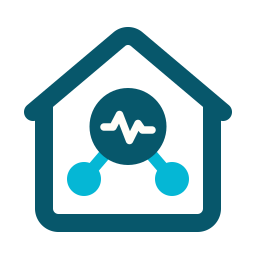
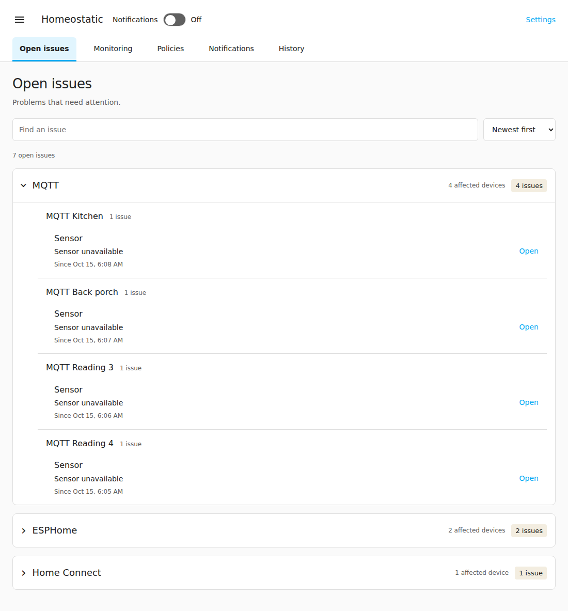

# Homeostatic

<picture><source media="(prefers-color-scheme: dark)" srcset="custom_components/homeostatic/brand/dark_icon.png"></picture>

Homeostatic helps you keep track of what needs attention in Home Assistant. It brings reported problems into one place and notifies people on their schedule.

As your installation grows, an unavailable switch or an integration waiting for you to sign in can be easy to miss. Home Assistant often already knows about the problem. Homeostatic helps you notice it and find where to take action.

## Why use Homeostatic?

- Catch up on routine problems in a morning summary, including low batteries and equipment Home Assistant reports unavailable.
- Give a sustained temperature problem an immediate notification, with reminders until someone acknowledges it or the condition clears.
- Investigate an integration failure together with its affected equipment. Follow links back to Home Assistant to take action.
- Keep a known issue visible while pausing its notifications. History lets you review how earlier problems ended.

You choose what to watch, when to hear about it and which configured Home Assistant destinations to use. Checks can also stay on the dashboard without sending notifications.

Example equipment in Open issues. Expand a group, then open a finding to inspect the problem.

## What it watches

A new installation watches integration, device and entity availability, Home Assistant Repairs, and automations that name missing entities. You can also configure battery checks, vacuum errors, UPS conditions, temperature limits and thermostat progress.

Browse equipment by integration, Home Assistant location, or optional [TopoMation](https://github.com/mjcumming/topomation) locations. Each source shows its current evidence and the checks that watch it. [The manual](docs/guide.md) explains the available monitoring and how to tailor it to your installation.

## Install and get started

You need Home Assistant 2026.9.3 or newer and an administrator account. The first load needs internet access to install its Python dependency; Homeostatic then runs locally.

In HACS, add `https://github.com/mjcumming/homeostatic` as a custom repository with type **Integration**, download Homeostatic and restart Home Assistant. Then use **Settings → Devices & services → Add integration** to add **Homeostatic**.

Common checks start enabled, with notification sending off. Review what Homeostatic finds, choose what matters to you, then decide who should hear about it.

Start with [Install Homeostatic](docs/install.md) for the full HACS or manual procedure, then follow [Your first monitoring setup](docs/manual/first-run.md) to test one phone destination and arrange a morning report.

## Read the manual

Start at the **[Homeostatic manual](docs/guide.md)**, or go directly to a task:

- [Review and respond to an issue](docs/manual/issues.md)
- [Choose what to monitor](docs/manual/policies.md)
- [Set up notifications](docs/manual/notifications.md)
- [Understand how issues work](docs/how-it-works.md)
- [Troubleshoot a problem](docs/troubleshooting.md)
- [Upgrade, roll back or remove Homeostatic](docs/manual/maintain-installation.md)

## Limits

Homeostatic uses what Home Assistant reports. Availability does not establish that a reading is fresh or a command succeeded. It cannot report an outage of Home Assistant itself while running inside it, and it does not repair equipment automatically. Automation-defined alerts are unfinished and are outside the current manual. See [What Homeostatic cannot establish](docs/manual/limitations.md) for the full scope.

## Contribute

[Contributing](CONTRIBUTING.md) explains development. The [specification](docs/spec.md) owns current behavior, and the [roadmap](docs/roadmap.md) describes unfinished work. The decision engine is the separate [health-tree](https://github.com/mjcumming/health-tree) library. Homeostatic is licensed under the [MIT license](LICENSE).
