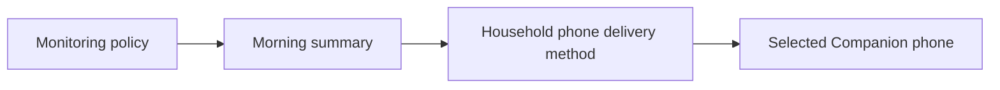

# Your first monitoring setup

[Homeostatic manual](../guide.md)

This tutorial takes you from an installed integration to monitoring you have reviewed and a morning report configured for one phone. You can finish it without a current equipment problem. Start after [installing Homeostatic](../install.md), using an administrator account.

For the phone steps, have the Home Assistant Companion app connected to this server with notification permission. Link the app's Home Assistant user to the intended person under **Settings → People**.

## 1. Check the starting state

Open **Homeostatic** in the sidebar. **Open issues** shows the current reported problems. Keep the **Notifications** switch off while reviewing the setup.

Open **Policies**. A fresh installation enables the supplied **Integrations**, **General entity availability**, **Cameras**, **Locks**, **Alarm panels**, **Safety sensors**, **Missing entities**, **Repairs**, **Broken automations**, **Batteries** and **Vacuums** policies. The supplied policies already select named notifications, but those notifications have no delivery methods yet. Temperature, thermostat and UPS policies need their sources and settings configured before enabling.

The other supplied policies start disabled, including **Jammed locks**, **Doors and windows left open** and the sensor-condition checks. Review their sources, detection settings and notifications in **Policies** before enabling them and selecting **Save policy**. The [monitoring reference](monitoring-reference.md) lists their starting selections and detection and recovery rules.

If Homeostatic has been configured before, the saved choices may differ. The [monitoring reference](monitoring-reference.md) lists fresh-install defaults; updates preserve your choices.

## 2. Inspect familiar equipment

1. Open **Monitoring** and search for a familiar device, such as a lamp or switch.
2. Select it and read the current condition and monitoring coverage.
3. Open one of its policy links to see which sources that policy watches.

Opening a policy changes nothing. For this walkthrough, leave its source selection as it is. Later, [Choose what to monitor](policies.md) explains how to narrow the selection or make an exception.

If an issue is open, inspect its finding in **Open issues** and follow its Home Assistant link if useful. If there are no current issues, continue. A missing reading can still need investigation in Monitoring; an empty issue list is not a complete equipment health check.

## 3. Save one phone delivery method

1. Open **Notifications → Delivery methods** and select **Add delivery method**.
2. Give the method a useful name, such as **Household phone**.
3. Select **Add destination**, choose **App notification** under **Delivery type**, then select your Companion phone. Selecting the destination closes the picker.
4. Leave presence-based selection off for this first setup.
5. Select **Save delivery method**. After the save returns to the list, open it with **Edit delivery method**.

The saved method should show the selected phone. If it is missing from the picker, check the app registration and person association before proceeding.

## 4. Request a test

Select **Send test** in the saved method's editor. This explicitly requests a test using that method, even while normal notifications are off. A changed method must be saved before testing.

Read the result, then check the phone. A successful request means Home Assistant was asked to send the message; receipt is something you verify on the destination. If the message does not arrive, use [No notifications arriving](../troubleshooting.md#no-notifications-arriving).

## 5. Connect the method to Morning summary

1. Return to the named notifications list and select **Edit notification** for **Morning summary**.
2. Review the time, days and displayed time zone. On a fresh installation it reports daily at 08:00 in Home Assistant's time zone.
3. Under **Send using**, select **Household phone**.
4. Inspect the listed policy uses, then select **Save notification**.

This is a shared notification: the change applies to all saved policies that use it. On a fresh installation, that includes General entity availability, Integrations, Missing entities, Repairs, Broken automations and Batteries. Cameras, Locks, Alarm panels and Safety sensors use Immediate, and Vacuums uses Evening summary. To receive those reports too, repeat these steps for **Immediate** or **Evening summary** and select **Household phone**. Creating a delivery method does not select it for any notification. Disabled policies remain disabled.

Open the policy you reviewed earlier and inspect its **Notifications** assignment. It should select **Morning summary**. If you change the assignment, select **Save policy**. Saving a notification does not save a pending policy edit.

The relationship is now:

## 6. Enable normal sending

Return to **Open issues** and review any problems that are already open. When ready, turn on the **Notifications** switch in the header. The switch applies immediately and saves independently of editor drafts.

Existing open problems become eligible under their saved notification choices. Morning summary waits for its next scheduled occurrence; enabling sending does not send that summary immediately. An empty report sends nothing. Other saved immediate assignments can request notifications after their configured collection delay when sending is enabled.

## Keep using it

Use **Open issues** for reported problems, **Monitoring** for equipment and its current evidence, and **History** for ended issues. You can leave this setup running, adjust [battery checks](batteries.md), and add [temperature limits](temperature.md) or other monitoring when needed.

For different timing, more destinations or presence choices, continue with [Set up and change notifications](notifications.md).
