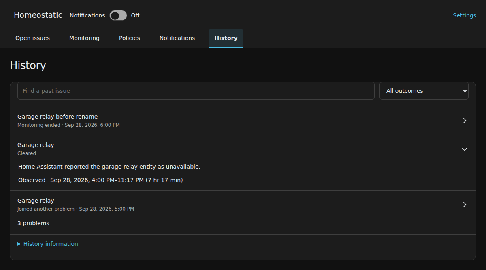

# Review ended problems

[Homeostatic manual](../guide.md)

Use **History** to find an issue that has ended and understand why it ended. Its recorded findings remain separate from the equipment's current condition.

## Find an entry

1. Open **History**.
2. Search with **Find a past issue**. Use the outcome selector to narrow the list when needed.
3. Select a row to expand its recorded condition and **Observed** time range. Select it again to collapse it.
4. Use **Previous** and **Next** when results span several pages.

Following a retained issue link opens History with that entry expanded, even when a previous search or page would have hidden it.

The expanded example retains the finding recorded when the Garage relay issue ended.

## Read the outcome

| Outcome | Meaning |
| --- | --- |
| Cleared | Homeostatic observed the recovery required by that check. A shared problem can clear while individual issues remain open. |
| Monitoring window ended | The configured hours ended for a left-open issue. Closure was not established. |
| Monitoring ended | The source left that monitoring scope. Recovery was not established. |
| Joined another problem | Homeostatic grouped the issue into another problem. Recovery was not established. |
| Issues separated | The problems continue as separate issues. Follow their links to inspect them; separation does not establish recovery. |

For **Joined another problem**, select **View related problem** when available. It opens the continuing issue or its retained History entry. If the related problem is no longer retained, History says so.

The **Observed** interval records when Homeostatic saw the opening and ending. If Home Assistant was stopped when equipment recovered, the recorded end can be later than the actual recovery. Renaming or removing equipment does not rewrite the name and findings already recorded for it.

## Check how much history is available

Expand **History information** to see the retention limits and when collection began. Earlier history is not reconstructed. The [settings reference](settings-reference.md) lists the retention bounds.

History records ended issues. Acknowledging an issue, pausing notifications or turning sending off does not end it and does not create a History entry. A problem can appear here even if it cleared before any notification was requested.

If a retained record lacks the old device or integration association, a source-specific history view may show fewer entries than the full History page. Search the full page before concluding that no earlier issue was recorded. Expired or absent entries cannot establish that equipment had no problems.

For the equipment's present condition, return to [Monitoring](monitoring.md). For a continuing problem, use [Open issues](issues.md).
