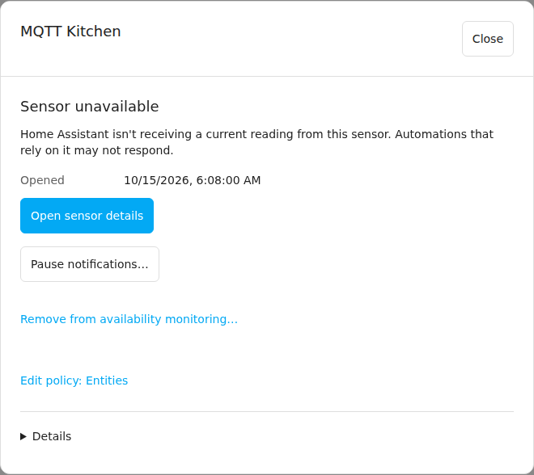

# Respond to issues

**Open issues** lists the problems Home Assistant is reporting now, grouped by integration and then by device. Use **Find an issue** to search by name, entity ID or condition, and **Sort issues** to change the order.

## Open an issue

Expand an integration and select **View** beside a device. The dialog shows every current issue on that device, whatever the check: availability, battery, temperature or anything else. **Open device** opens the device in Home Assistant. **Policies:** and **Notifications:** list what covers these issues; select a name to open that editor, and **Back to issue** to return.

**View** on a device in **Monitoring** opens the same dialog.

Issues that don't belong to a single device open on their own: an entity without a device, a failed integration, a Repair or a broken automation. A failed integration's issue lists all the equipment it affects.

## Acknowledge or pause

When a device has several issues, they all start selected. Clear any you want to leave alone, then choose:

- **Acknowledge selected** to record that someone has seen them. Reminders that wait for acknowledgment stop, and summaries still include them.
- **Pause notifications…** to hold every notification about them, for everyone, for 1, 4 or 24 hours. Pausing again extends a pause.
- **Resume notifications** to end their pauses early.

With one issue the first button reads **Acknowledge issue**. Acknowledging or pausing doesn't change monitoring, and the issues stay open until their checks see recovery. New issues don't inherit an acknowledgment or a pause. If an action fails for one issue, the dialog says which.

## Stop watching something

If Home Assistant often reports an entity unavailable and you don't need to know, select **Stop monitoring** in the issue. The confirmation lists the exact entities. Their availability checks stop and the issues end as **Monitoring ended**; other checks on them, such as battery or temperature, continue. [Choose what to watch](policies.md#stop-or-resume-availability-monitoring) explains how to undo it.

## From a notification

Tapping a notification about one issue opens that issue. A notification about several opens **Issues in this notification**, showing the ones still open, and **Show all open issues** takes you to the full list. Tapping doesn't acknowledge anything. The **Acknowledge** button on a phone notification acknowledges only the issues in that message.

## When an issue ends

An issue ends when its check sees recovery. Availability issues wait a little first, so a device that flickers back and drops off again stays one issue; [Defaults and settings](settings-reference.md#installation-timing) lists the wait. An availability issue whose current state is unknown, or that is waiting out that confirmation, leaves **Open issues** but stays visible on its source in **Monitoring**.

**History** keeps the last 100 ended issues from the past 30 days. Search with **Find a past issue**, and select a row to see what was recorded and when.

| Outcome | Meaning |
| --- | --- |
| Cleared | The check saw the problem end. |
| Monitoring ended | The source stopped being monitored, or its policy changed. The problem may still be there. |
| Joined another problem | The issue became part of a bigger one, such as a failed integration. **View related problem** opens it. |
| Issues separated | A grouped issue split up, for example after its integration recovered. Each problem continues as its own issue. |

## Maintenance windows

Automations and scripts can hold off new issues for equipment during planned work with the [`homeostatic.start_maintenance`](../reference.md#homeostaticstart_maintenance) action. While a window is active, its source in **Monitoring** shows **Working on equipment** and when it ends. Issues that were already open, and their notifications, carry on. Select **End maintenance…** to end a window early.
