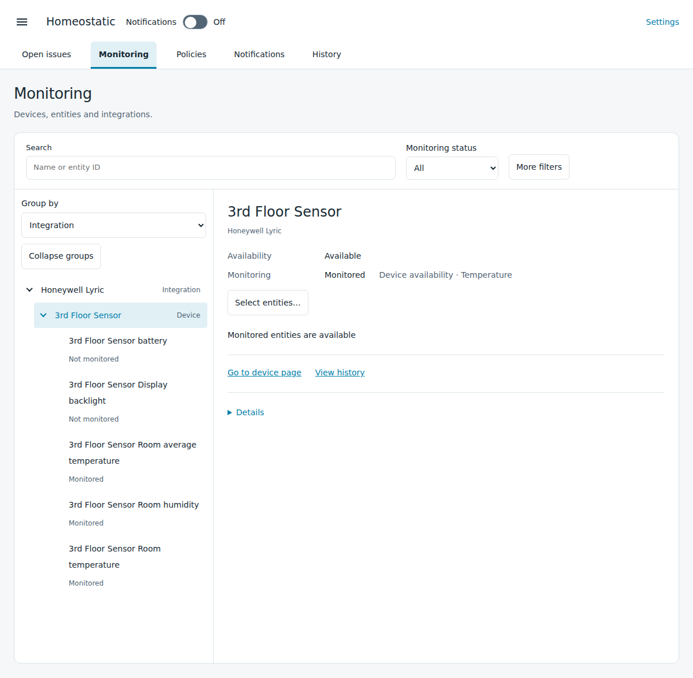

# Inspect equipment and its monitoring

[Homeostatic manual](../guide.md)

**Monitoring** shows the integrations, devices and entities Homeostatic has discovered, their current evidence and the policies that watch them. Looking at a source does not change its monitoring.

## Find a source

1. Open **Monitoring** and enter a name or entity ID in **Search**.
2. Leave **Monitoring status** at **All** to search both watched and unwatched sources. Choose **Monitored** or **Not monitored** when that distinction helps.
3. Use **Group by** to browse by integration or **Home Assistant location**. **TopoMation locations** is also available when TopoMation supplies the location tree.
4. Expand the relevant branch and select the source. On a narrow screen, **Back to Monitoring** returns to the tree.

The details identify the source, its current condition and its monitoring. Links beside its name open the named Home Assistant destination, such as the device page or entity state.

An **Issues** badge marks a source or group with related open issues. A shared issue may appear under more than one device or room. Select **View issue** to inspect its full scope before acknowledging it or pausing notifications.

This example device shows its current availability alongside the checks that watch it.

## Understand what is watched

1. Select the source and read its monitoring summary.
2. Review the contributing policies. A source may have several checks, such as device availability, individual entity availability and battery condition.
3. Open the relevant policy to inspect its selection and settings. The editor shows the policy's complete scope, which may include other equipment.
4. Follow [Choose what to monitor](policies.md) if that scope needs changing.

A device can be available while one of its entities is unavailable. The device assessment and each policy's selected evidence can also differ when a policy excludes some entities. Read the individual findings before treating the device summary as an answer about every feature. [How Homeostatic works](../how-it-works.md#availability-and-missing-readings) explains the state meanings.

## Find an excluded or disabled source

1. Clear the search if it may be hiding the source, and set **Monitoring status** to **All**.
2. Open **More filters**.
3. Select **Include disabled sources** to show equipment disabled in Home Assistant. Select **Availability exclusions only** to find sources with saved availability exclusions.
4. Open the source and inspect its condition and policies.

Disabled sources are hidden by default and do not acquire availability checks. Their saved choices apply again when they are enabled in Home Assistant. Resuming an availability exclusion is a separate operation; [the policy guide](policies.md#resume-availability-monitoring) explains it.

Search, filters, **Group by** and **Collapse groups** change the displayed list. They do not enable policies, exclude equipment or change an issue. A selected source can remain open after a filter removes it from the tree.

## Check an evidence gap or earlier problem

Use the source details when **Open issues** has no current availability warning but a reading is missing or recovery is still being confirmed. The details preserve that distinction instead of treating every quiet source as recovered.

Open [History](history.md) to find ended problems. A retained issue link opens its recorded entry. History describes what Homeostatic saw at the time; current source readings belong in Monitoring.

The [monitoring reference](monitoring-reference.md) lists eligible sources and the evidence each check uses. If an expected source is still missing, see [Troubleshooting](../troubleshooting.md).
