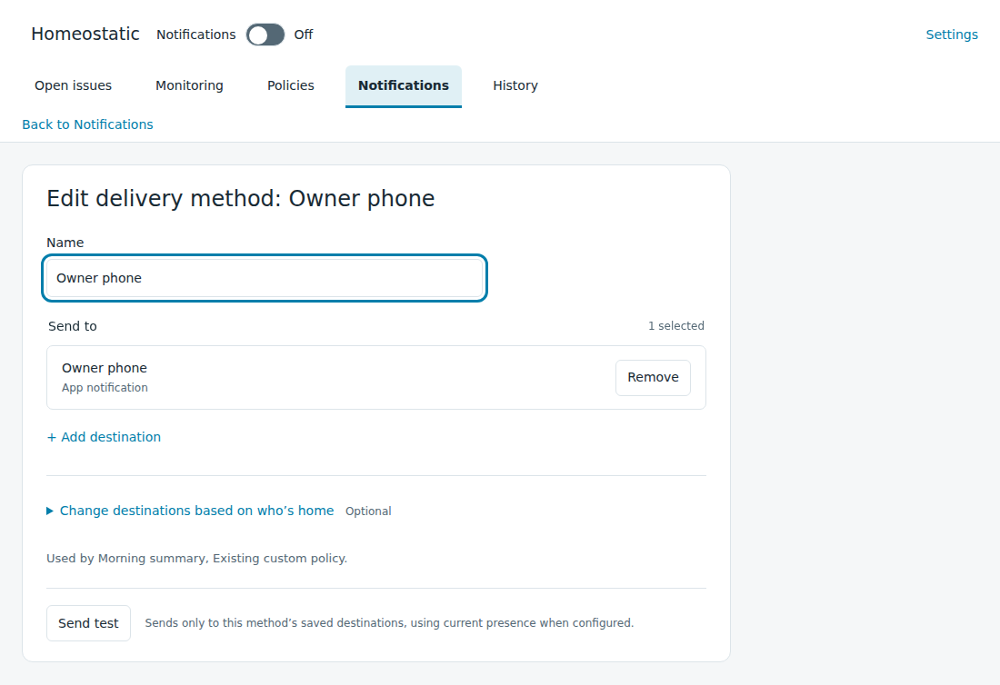
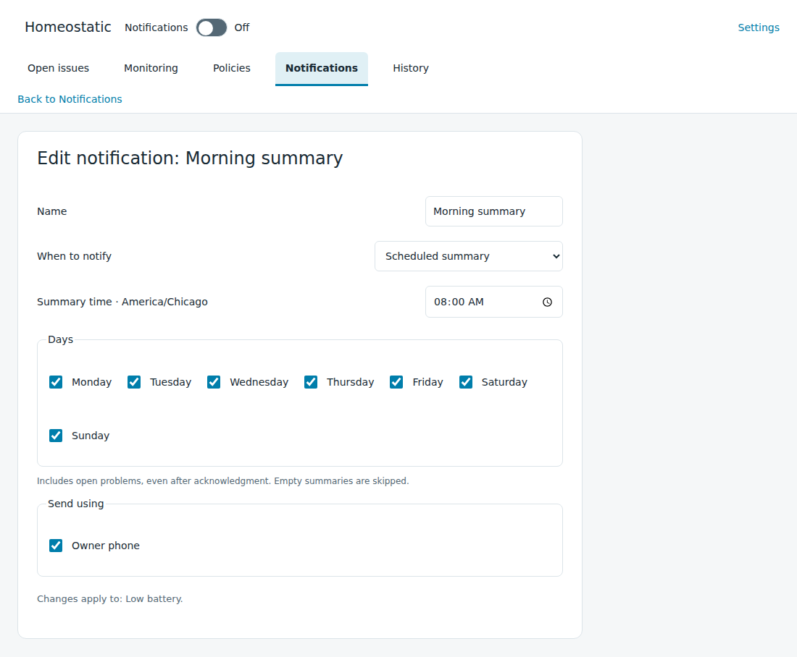

# Set up and change notifications

[Homeostatic manual](../guide.md)

Use **Notifications** to choose when people hear about problems and where the messages go. A [monitoring policy](policies.md) selects a named notification, such as Morning summary. That notification selects one or more delivery methods, such as a phone or a speaker.

Start with an administrator account and a notification destination already configured in Home Assistant. For a phone, install and connect the Home Assistant Companion app first. The destination picker shows the supported destinations available to this installation.

## Save and test a delivery method

1. Open **Notifications → Delivery methods** and select **Add delivery method**.
2. Enter a useful name, such as `Household phones`.
3. Select **Add destination**, choose a **Delivery type**, then select a destination. Search by name or room if needed. A speaker with several speech providers asks you to choose a provider; an SMS destination asks for a recipient number.
4. Add any other destinations this method should use. Leave presence selection at **Fixed destinations** for the simplest setup.
5. Select **Save delivery method**. When the confirmed save returns to the list, select **Edit delivery method** to reopen it.
6. Select **Send test** in the saved, unchanged editor, then check the destination yourself.

The test uses only this method's saved destinations and current presence rules. It works while the global **Notifications** switch is off and does not turn that switch on. Saving alone does not send a test. After editing a method, save it again before testing.

The result lists the requested deliveries, failures or a presence-related skip. A requested result means Homeostatic asked Home Assistant to send; check the phone, speaker or other destination to establish receipt. See [supported destinations](settings-reference.md#delivery-destinations) for capabilities and prerequisites, or [troubleshooting](../troubleshooting.md) if the expected destination or message is missing.

This example method has a saved phone destination. Testing is a separate action after saving.

## Choose when to send

1. Return to the **Notifications** view. Select **Edit notification** on an existing choice, or **Add notification** to create one.
2. Set the name and **When to notify**. Choose immediate delivery, acknowledgment reminders, daily delivery hours or a scheduled summary. The [settings reference](settings-reference.md#named-notifications) lists the starting choices and timing fields.
3. Under **Send using**, select the saved delivery method or methods to use.
4. Read **Changes apply to** before saving. It identifies the saved policies that use this notification.
5. Select **Save notification**.

For example, Morning summary can use Household phones and report open equipment problems each morning. A notification with no selected delivery method remains saved but sends nothing.

The times beside **Start**, **End** and **Summary time** use the displayed Home Assistant time zone. A daily delivery window holds requests outside its hours until the next opening. If the problem ends first, that delayed message is no longer needed. A scheduled summary includes eligible open problems, including acknowledged ones; empty summaries are skipped.

The example Morning summary uses the Owner phone method. **Changes apply to** identifies the policies affected by an edit.

## Assign the notification to a policy

1. Open **Policies** and select **Edit policy** for the policy that watches the equipment.
2. In its notification section, use **Add notification** and choose a saved notification. To change an existing assignment, select its replacement in that row.
3. Review the timing and delivery shown below the selected name. UPS low-reserve assignments also specify whether they apply on mains or backup power.
4. Select **Save policy**.

A policy can use several notifications. For example, a temperature policy could request immediate acknowledgment and also appear in a morning summary. Each assignment keeps its own timing. Compatible messages about the same equipment may be combined for delivery.

To keep a policy on the dashboard only, select **Remove** on each notification assignment and save the policy. It then shows **No notifications**; its issues still appear in Open issues. This does not change other policies that watch the same equipment.

Older saved assignments may show **Custom notification — keep current settings**. Leaving that choice in place preserves its existing timing and destinations. Selecting a named notification deliberately replaces those settings for that assignment.

## Turn sending on or off

Use the **Notifications** switch in the panel header after the methods, named notifications and policy assignments are saved. The switch saves independently of editor drafts. Monitoring and Open issues continue while sending is off.

When sending is enabled, already-open problems can become eligible under their saved instructions. Immediate notifications may be requested then. Daily-hours delivery waits for its open window when necessary, and a scheduled summary waits for its next occurrence. A saved summary assignment can show its next scheduled time in the policy editor; unsaved changes need to be saved before that forecast is available.

Use [Pause notifications](issues.md) for one open issue or [Working on this equipment](maintenance.md) before planned work. The [control comparison](settings-reference.md#issue-and-equipment-controls) explains their different effects.

## Choose destinations using presence

Open a delivery method and expand **Change destinations based on who’s home**. Choose one of these **Presence selection** modes:

| Mode | What to configure | How a destination is chosen |
| --- | --- | --- |
| Fixed destinations | The destinations under **Send to** | Every request uses those destinations. |
| Home or away | The people to check, **When someone is home**, and **When everyone is away** | Any selected person reported home selects the home destinations. All selected people must have known away states to select the away destinations. |
| People currently home | The people to check and a destination for each | Requests use the configured destinations of selected people reported home. |

For either presence-based mode, complete **When no recipient can be chosen**. Select **Skip notification**, or choose destinations under **Send to instead**. Unknown, unavailable, missing or restored presence readings cannot establish that someone is home or away. For Home or away, a known home person still selects the home destinations even if another person's presence is unknown. For People currently home, fallback applies when nobody selected is known to be home.

For example, Home or away could announce through the kitchen speaker while someone is home and use household phones when everyone is away. A phone fallback also handles uncertain presence. Save the method and use **Send test** to check the choice made from current presence; a skipped test explains that no recipient qualified.

## Change shared settings or remove them

A delivery method can serve several named notifications, and a named notification can serve several policies. The editor lists the saved uses affected by an edit. To change just one policy's arrangement, create or duplicate a notification, configure it and assign it to that policy. To change just that notification's destinations without affecting other uses of a method, give it a separate method.

Each **Save policy**, **Save notification** and **Save delivery method** action saves only that editor. Moving between them within the same tab preserves pending drafts; saving a shared definition does not save a pending policy assignment. Do not rely on an unsaved draft surviving a browser reload or tab closure. Use **Discard changes** to return the current editor to its saved values.

Timing, destination and presence changes apply to already-open issues when saved. Immediate reporting can request another message; scheduled summaries wait for the next occurrence. Renaming alone preserves the existing timing and acknowledgment state. If applying a save fails or disconnects, read the displayed status and keep the pending edits until the outcome is clear.

To delete a saved notification or method, open its **More actions → Delete** menu. If it is used, choose a replacement or explicitly remove its uses. Removing a policy's last notification leaves dashboard-only monitoring. Removing a named notification's last delivery method leaves that notification unconfigured. A deletion that conflicts with relevant pending drafts must be resolved before it can finish.

## Use a phone notification

Tap an individual issue notification to open its Homeostatic context. Device messages and summaries open Open issues. If an individual issue has ended, its link can open the retained History record. Tapping a message does not acknowledge or clear it. Opening the panel still requires a Home Assistant administrator account; the notification link grants no additional access.

The **Acknowledge** button on an active issue or device message records awareness of the issues represented by that message and stops their acknowledgment-dependent reminders. It does not acknowledge a later problem that happens to use the same equipment. Scheduled summaries can still include the acknowledged issues. See [review and respond to an issue](issues.md) for the equivalent panel action.

Immediate notification choices request critical alerts on iPhone and use the **Homeostatic urgent** channel on Android. **Urgent**, the supplied daily-hours choice, uses normal notification priority. Review the phone's notification permissions and channel settings as part of setup. Phone delivery supports updates and clearing of existing messages; other destination types receive new messages without those phone controls.
