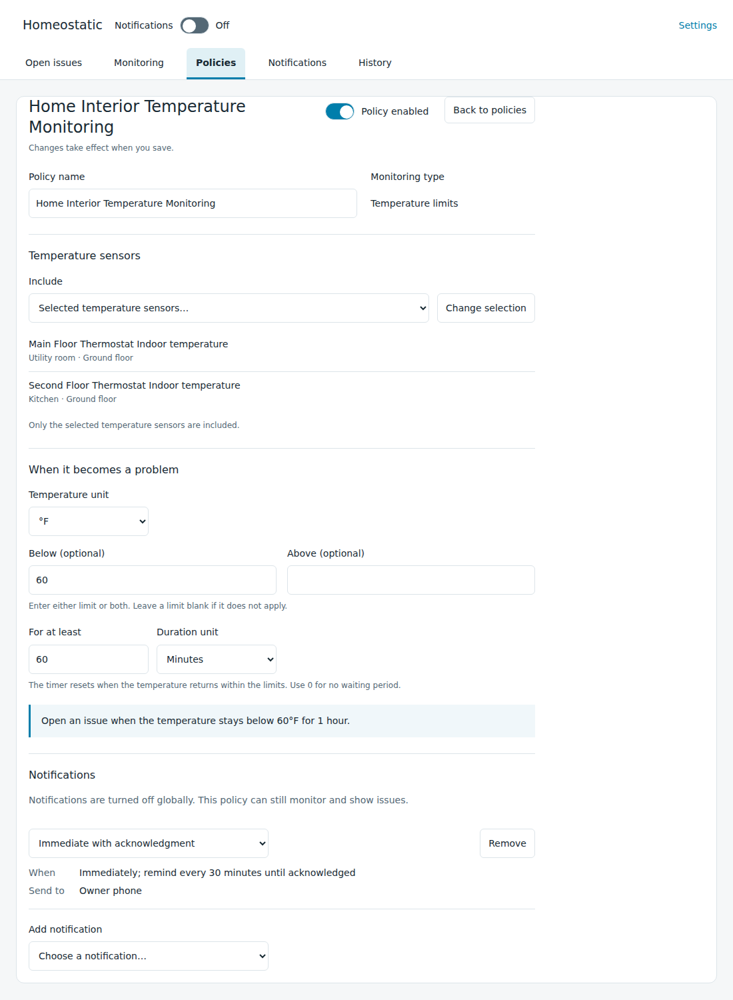

# Watch temperature limits

[Homeostatic manual](../guide.md)

Use **Temperature limits** to watch a selected temperature sensor against a lower limit, an upper limit or both. Choose how long an out-of-range reading must continue before it becomes an issue. This supports different settings for each place you want to watch.

Before starting, confirm that Home Assistant exposes the source as a temperature sensor with a numeric reading and a supported temperature unit. Decide which limits and duration suit its location and purpose; Homeostatic supplies no general safe range.

## Add the policy

1. Open **Policies → Add policy**, choose **Temperature limits**, and select **Continue**.
2. Name the policy. Under **Include**, choose **Selected temperature sensors…**, select the sensor and choose **Done**. Use separate policies when sensors need different limits or notifications.
3. Choose **Temperature unit**. Enter **Below (optional)**, **Above (optional)**, or both. Leave an unused limit blank. If both are entered, Below must be less than or equal to Above.
4. Set **For at least** and its **Duration unit**. Choose the duration deliberately; `0` detects an out-of-range reading without waiting. Read the rule summary beneath the fields to check the complete condition.
5. Review **Notifications**. A new policy selects **Immediate with acknowledgment** when that named notification exists. Configure its delivery method through [Set up and change notifications](notifications.md), or remove assignments for panel-only monitoring.
6. Turn **Policy enabled** on and select **Save policy**. Return to the sensor in **Monitoring** and confirm the policy, limits and current reading.

This example uses a 60°F lower limit and a one-hour wait. Choose values for the equipment and location you are monitoring; these are not supplied defaults.

## Follow the reading

While a temperature remains outside the range but has not reached the configured duration, Monitoring shows **Waiting**. A reading exactly on a limit is within range. An in-range reading cancels the wait or clears an open temperature issue without another recovery threshold.

The duration measures a continuous observed out-of-range condition. If a reading jumps directly from below the lower limit to above the upper limit, the same wait or issue continues: no in-range reading was observed. Separate low-only and high-only policies give those conditions independent issues if that is useful.

Missing, unknown, unavailable, restored or invalid readings break a pending wait. A fresh interval starts when usable evidence returns. An existing temperature issue stays open until a usable reading establishes recovery. A restart also restarts pending waits and preserves already-open issues; downtime is not counted toward a new temperature issue.

Changing limits, duration or other detection settings ends the old monitoring expectation and starts the new one. A rename preserves it. Review the saved policy after a change and use [History](history.md) to distinguish monitoring ending from observed recovery.

[Thermostat progress](thermostats.md) watches movement toward a thermostat's target. Temperature limits use the bounds you enter here. See [Monitoring types and defaults](monitoring-reference.md) and [What Homeostatic cannot establish](limitations.md) for supported readings and detection limits.
